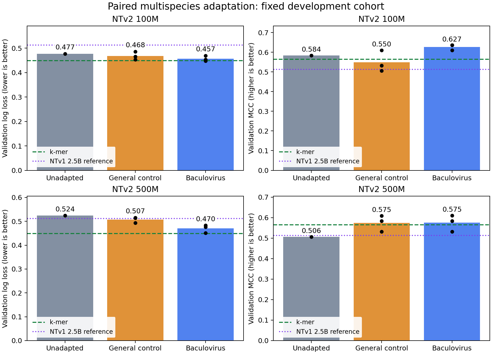
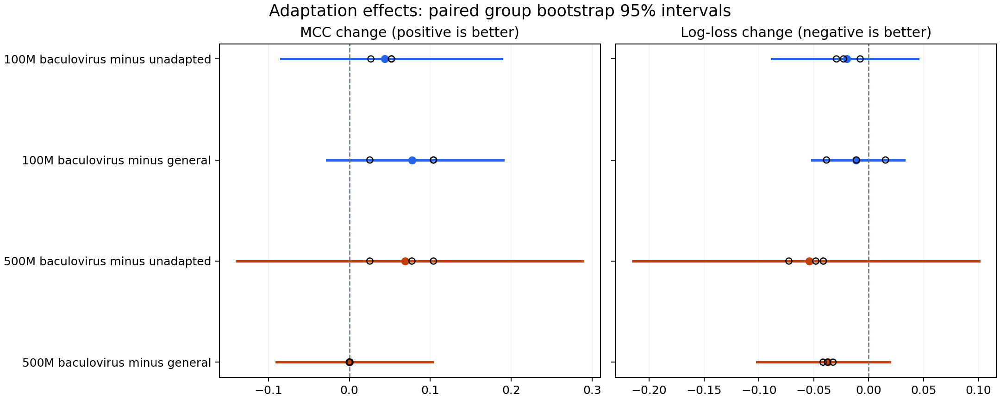

# Baculovirus adaptation of multispecies NT models — October 23, 2026

Baculovirus continued pretraining improved the point estimates for both NTv2 sizes, but this experiment does **not establish that baculovirus-specific adaptation is necessary**. Every primary paired 95% interval includes zero. At 500M, the MCC improvement is almost identical after general-genome continued pretraining. The 100M baculovirus-adapted model has the highest observed MCC; k-mers retain the lowest log loss and highest ROC AUC. These are validation results on one AcMNPV genome, not a new external test.

The complete twelve-run primary panel, source/checkpoint verification, uncertainty analysis and an exploratory frozen 2.5B multispecies reference finished within the authorized two-hour window. No scientific jobs remain running. The downstream dataset is unchanged, and no real test predictions were generated.

## Fixed validation comparison

All NT entries use frozen final-layer masked-mean embeddings and standardized L2 logistic readouts. Pooling and C=0.01 were independently selected using **training-only grouped validation** on unadapted representations, then held fixed across each size's before/after arms. Readout fitting and scaling use only the 233 training windows; this table evaluates the same 77 validation windows (64 groups). The threshold is fixed at probability >0.5.

| Model | Additional pretraining | Log loss ↓ | MCC ↑ | ROC AUC ↑ |
|---|---|---:|---:|---:|
| NTv2 100M | None | 0.477 | 0.584 | 0.848 |
| NTv2 100M | General control | 0.468 ± 0.016 | 0.550 ± 0.054 | 0.859 ± 0.014 |
| NTv2 100M | Baculovirus | 0.457 ± 0.011 | **0.627 ± 0.015** | 0.867 ± 0.011 |
| NTv2 500M | None | 0.524 | 0.506 | 0.824 |
| NTv2 500M | General control | 0.507 ± 0.012 | 0.575 ± 0.040 | 0.832 ± 0.008 |
| NTv2 500M | Baculovirus | 0.470 ± 0.017 | 0.575 ± 0.040 | 0.857 ± 0.008 |
| Oriented 1–4-mer logistic | None | **0.449** | 0.565 | **0.882** |
| NTv1 2.5B multispecies* | None | 0.512 | 0.513 | 0.847 |

Adapted entries show mean ± sample SD across adaptation seeds 42/43/44, not independent biological replicates. Unadapted entries are deterministic references; their repeated cached embeddings match exactly within this study. No seed ensemble or best-seed selection is used. *The 2.5B model is an exploratory practical reference: generation and pretraining history also differ, so this does not isolate model size. No 2.5B adaptation was run.*

Bars are mean seed-specific scores; dots are individual seeds. Reference lines show k-mers and the exploratory unadapted 2.5B model. Different metrics need not rank models identically.

## Paired effects and uncertainty

Each interval uses 2,000 paired resamples of the same 64 validation groups. Each resample averages the seed-specific metrics within an adapted condition. These intervals condition on the dataset, trained models and accepted strand/group policy; they do not capture all training/selection uncertainty or establish independent biological replication.

| Comparison | MCC change [95% interval] | Log-loss change [95% interval] |
|---|---:|---:|
| 100M baculovirus − unadapted | +0.044 [−0.084, +0.188] | −0.020 [−0.088, +0.045] |
| 100M baculovirus − general | +0.078 [−0.028, +0.190] | −0.011 [−0.052, +0.032] |
| 500M baculovirus − unadapted | +0.069 [−0.139, +0.289] | −0.054 [−0.215, +0.101] |
| 500M baculovirus − general | +0.0003 [−0.090, +0.103] | −0.037 [−0.102, +0.019] |

Positive MCC and negative log-loss changes favor baculovirus adaptation. **All primary intervals cross zero.** For 500M, the general control increases MCC by +0.0686 versus +0.0689 for baculovirus; an improvement over the unadapted model alone would therefore overstate evidence for a baculovirus-specific classification benefit. Baculovirus has a better log-loss point estimate than the general control, but that interval also includes zero.

Filled points are mean effects; lines are paired group-bootstrap 95% intervals. Open circles show seed-specific effects and are not biological-replication intervals.

Supplementary fixed-model comparisons against k-mers also remain unresolved: baculovirus-adapted 100M minus k-mer MCC is +0.063 [−0.168, +0.306]; 500M is +0.011 [−0.198, +0.214]. Their log-loss point estimates are worse than k-mers by +0.008 and +0.022 respectively, with intervals crossing zero. These comparisons involved no further fitting or selection. Full values are in [kmer-reference-comparisons.json](kmer-reference-comparisons.json).

## What this answers for the project

The study tests the value of adaptation **from broad-genome pretrained models**, rather than attributing poor transfer to human-only pretraining. NTv2 100M/500M are compared with themselves before and after adaptation, under a fixed readout procedure, and with an equal-budget general-genome control.

The results support a modest, reproducible direction of improvement across these adaptation seeds, especially the 100M MCC point estimates. They do not yet demonstrate a reliable advantage attributable specifically to baculovirus exposure, nor a clear practical superiority over k-mers. The exploratory 2.5B reference does not improve the point estimates over unadapted 100M, so a larger pretrained model is not automatically a stronger probe on this cohort; this is not a causal size comparison.

**Current decision:** baculovirus adaptation is a promising option for this TSS-window task, but the present evidence does not justify calling it necessary. This is not proof that adaptation is ineffective. A larger independent annotated evaluation is more informative for that claim than a performance-driven expansion of this small validation sweep. The conclusion is conditional on this corpus, 512-step adaptation regime, frozen readouts and AcMNPV sampling definition; it does not cover every NT layer/readout, supervised fine-tuning, longer adaptation or all baculoviruses.

## Adaptation design and corpus

Primary checkpoints (all InstaDeepAI):

| Checkpoint | Pinned revision |
|---|---|
| nucleotide-transformer-v2-100m-multi-species | f34324c6fde36a4f635f0f1f06cac5d25acd6798 |
| nucleotide-transformer-v2-500m-multi-species | 06615c1660c892fc199840c18123f8385b3542a8 |
| nucleotide-transformer-2.5b-multi-species (frozen exploratory) | b746b125aacd1b0970c05a32fd71ba726754542e |

The existing 97 baculovirus genomes were audited. AcMNPV NC_001623.1 was excluded; the remaining records form 91 species/duplicate groups, of which 9 were held out before windowing. Training uses 87 accessions in 82 groups, 7,082 non-overlapping 1,536-base ACGT loci with both orientations (14,164 windows). The held-out corpus has 1,448 windows; a fixed 128-window subset with fixed masks selects adaptation checkpoints. Related different species remain, so this is target-excluded adaptation, not strict unseen-clade evaluation.

The general control samples 7,082 loci from versioned yeast, C. elegans and D. melanogaster assemblies listed in the original NT source manifest, also including both orientations for 14,164 windows. It matches unique-locus count, strand pairing, lengths, training-window count, optimizer steps and paired masked-token exposure. It does not match species diversity or GC composition: mean GC is 0.419 for baculovirus versus 0.386 for general. The control is a three-organism subset, not a reconstruction of the original 850-genome mixture. Thus the domain comparison concerns these specified corpora rather than isolating a particular regulatory mechanism.

All twelve runs train for 512 steps, effective batch 32, AdamW lr 1e-5, weight decay .01, 26-step warmup then cosine decay, BF16 autocast with FP32 parameters/optimizer, and standard 15% MLM masking excluding special tokens. Each processes exactly **4,210,688 input tokens**. Each paired seed has the same masked-token count in both corpus conditions (approximately 629,000). No supervised TSS labels enter MLM training or checkpoint selection.

Checkpoints at steps 128/256/384/512 are eligible; the lowest fixed held-out baculovirus MLM loss selects the trained state for either corpus condition. All baculovirus seeds selected step 512. General selected 128/128/128 for 100M and 256/256/128 for 500M. Therefore the **maximum training budget and selection procedure** are matched; selected-checkpoint exposure can differ. Both arms still paid the full 512-step cost. This selection never consulted adapted TSS performance. Initial held-out MLM loss fell from 8.102 to about 6.854 for 100M baculovirus and from 7.223 to about 6.723 for 500M baculovirus; improved MLM loss alone is not evidence of improved TSS prediction.

## Actual compute and memory

Times below sum the three valid scientific seed jobs within each condition. Allocation time includes startup, extraction, saving and checks; training-section time includes scheduled MLM evaluation/save overhead. Different allocations and microbatches mean runtime is not a pure model-size scaling comparison.

| Model/condition | Training-section minutes | Allocated minutes | GPU allocation | Peak allocated GPU GB |
|---|---:|---:|---|---:|
| 100M baculovirus | 15.82 | 18.50 | H100 MIG 2g.20gb | 3.18 |
| 100M general | 15.83 | 18.48 | H100 MIG 2g.20gb | 3.18 |
| 500M baculovirus | 7.45 | 12.32 | Full H100 | 19.07 |
| 500M general | 6.75 | 10.02 | Full H100 | 19.07 |

100M used microbatch 4 / accumulation 8; 500M used microbatch 16 / accumulation 2. The full H100 was selected for scheduling availability after the 40GB MIG request remained queued; this is not a claim that 500M required an 80GB card. Peak reserved memory was about 3.26GB and 20.17GB respectively. Memory is reported in decimal GB from recorded bytes.

The frozen 2.5B extraction/source verification took 104 allocated GPU seconds, with 58.4 seconds inside its program and 10.71GB peak allocated GPU memory; its CPU readout job took 24 seconds. This measures short-window frozen inference, not 2.5B training memory. All prior/excluded attempts, engineering jobs and verification jobs remain visible in [jobs.psv](jobs.psv); the table above excludes them rather than hiding them in scientific training totals. [compute-cost.json](compute-cost.json) contains exact valid-job mappings and totals.

## Engineering corrections and verification

Two issues were corrected before adapted TSS outcomes were inspected:

1. Original smoke jobs failed because rotary-position tensors cached under inference_mode could not be reused in backward. Trainable evaluation/extraction now uses no_grad. Original failures are preserved and excluded.
2. The initial general sampler selected individual strands instead of paired genomic loci. All original controls were preserved separately and excluded; all general seeds were rerun from the same pretrained checkpoints with repaired locus-first pairing. Baculovirus runs and downstream data were unchanged. The original control hash starts 6ceb8e08; valid repaired control hash is 6455320fd95ae86d27d32c80c101b18c9529cc064f252e7972181a947d852e04. The final report rejects the old hash.

Verification completed:

- **25 local regression tests passed**, 2 opt-in large pretrained tests skipped. New coverage includes evaluation followed by backward, fixed-mask invariants, token limits, strand pairing, full/partial analysis gating and bootstrap metrics checked against scikit-learn.
- All initial MLM parameters, including prediction heads, exactly match pinned pretrained source files; the 2.5B source tensors and shard hashes also match.
- All twelve selected adapted states reload exactly, and fresh GPU processes reproduce **all training/validation CLS and mean embeddings with zero difference**.
- All checkpoint selections match the eligible validation history. Paired input/masked-token counts and corrected corpus hashes match.
- All 16 readouts, including k-mer and the 2.5B reference, replay locally within **4.45e-16** maximum absolute probability difference. Metrics recompute, and stored scaler statistics match training-only means/standard deviations.
- Independently frozen pooling/C choices match final analysis. Partial and full development calculations use the same fixed procedure; repeated deterministic reporting did not trigger retuning.
- The historical 500M baseline has only small floating-point extraction differences; historical validation decisions are unchanged. [Continuity evidence](baseline-continuity.json).
- All train/validation/test CSV hashes match preparation. The real test file was hashed for identity only; **no real test predictions were generated** in this window. [Dataset integrity](downstream-integrity.json).

The original arrays' aggregate CANCELLED states reflect deliberately excluded/cancelled general tasks, not failed baculovirus tasks. Valid task IDs and exclusions are recorded in [window-record.md](window-record.md). Full models remain on Nibi under runs/2026-10-21/scientific/; compact local copies are under runs/2026-10-23/collected/.

## Artifacts and next step

[Full development metrics and fold-selection evidence](development-metrics.json), [independently frozen readout choices](frozen-readout-selection.json), [per-run training/cost summary](training-summary.csv), [run provenance](run-provenance.json), [source fidelity](source-fidelity.json), [readout verification](readout-verification.json), [fresh 100M replay](fresh-replay-100m.json), [fresh 500M replay](fresh-replay-500m.json), [corrected corpus](corpus-report-v2.json), [corpus verification](corpus-verification-v2.json), and [2.5B reference](capacity-reference.json) accompany per-window validation predictions.

[Reproduction instructions](reproduction.md) preserve the corrected execution and analysis paths. The next decision is whether to confirm these modest effects on a larger independent annotated cohort or predeclare a further adaptation-budget study. Do not tune the held-out test or claim general necessity from these validation results.
