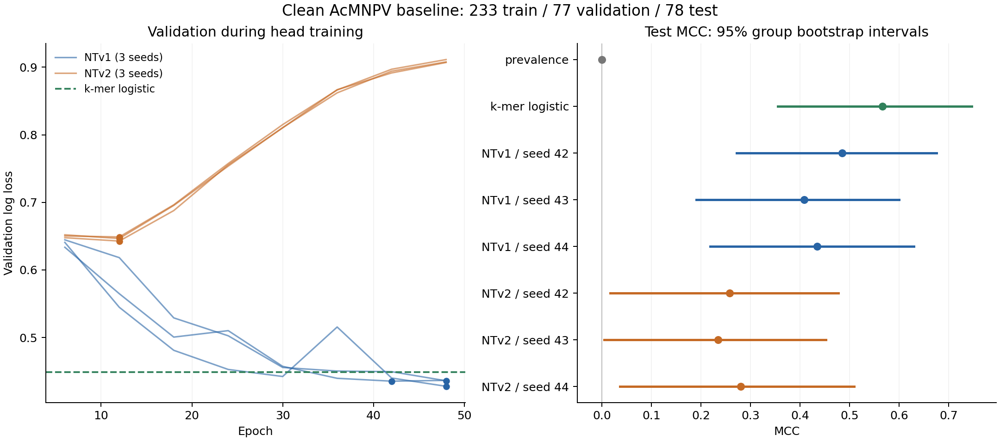

# First clean viral baseline results — October 19, 2026

The simple k-mer baseline has the highest observed mean test MCC in this fixed comparison. This is a small, within-AcMNPV benchmark under the agreed strand policy; it does not establish transfer to unseen viruses or a human–virus performance gap. The model comparison uses only the corrected runs described below.

## Comparison

| Model | Accuracy | MCC | ROC AUC | Log loss |
|---|---:|---:|---:|---:|
| Training prevalence | 0.526 | 0.000 | 0.500 | 0.692 |
| 1–4-mer logistic regression | 0.782 | 0.566 | 0.880 | 0.449 |
| Frozen NTv1 500M | 0.722 ± 0.020 | 0.443 ± 0.039 | 0.784 ± 0.004 | 0.567 ± 0.002 |
| Frozen NTv2 500M | 0.628 ± 0.013 | 0.257 ± 0.023 | 0.659 ± 0.010 | 0.700 ± 0.007 |

NT entries show mean ± sample standard deviation across seeds 42, 43 and 44, all on the same split; these are not independent biological replicates. Deterministic baselines have one result. Higher accuracy/MCC/AUC and lower log loss are better. The decision rule is fixed argmax (equivalently probability >0.5 for class 1); no threshold was tuned on test.

The split has 233 training, 77 validation and 78 test samples; test comprises 64 genomic groups. Both encoders are frozen, use raw CLS embeddings and the same 512-unit GELU head, and train for 50 epochs at learning rate 0.0003 with batch size 50. Source model revisions are pinned. The k-mer model standardizes 340 oriented word-frequency features using training statistics; validation selected C=0.01 from the declared grid. Models are not refit on validation after selection.

Circles in the left panel mark selected saved checkpoints. The right panel's intervals resample test groups, with the trained models held fixed. They measure uncertainty conditional on this dataset and the chosen grouping policy; they do not include all training uncertainty or establish biological independence of opposite-strand overlaps.

## Uncertainty and selection

- NTv1 mean-seed MCC minus k-mer MCC: **-0.124**, 95% paired group-bootstrap interval **[-0.296, +0.050]**.
- NTv2 mean-seed MCC minus k-mer MCC: **-0.309**, 95% paired group-bootstrap interval **[-0.557, -0.057]**.

The NTv1 interval includes zero, so this test does not clearly resolve its difference from the k-mer baseline. The NTv2 interval lies below zero under this bootstrap; that remains a result conditional on this small, single-genome benchmark.

These use 2,000 paired resamples of the same 64 test groups, averaging the three seed-specific MCCs within each resample for each NT family. Interpret intervals against zero and alongside their small-cohort limitations; do not interpret seed spread as an estimate from three new datasets.

| Probe | Selected epoch | Validation loss | Test MCC |
|---|---:|---:|---:|
| ntv1-seed42 | 48 | 0.4277 | 0.485 |
| ntv1-seed43 | 48 | 0.4358 | 0.408 |
| ntv1-seed44 | 42 | 0.4353 | 0.434 |
| ntv2-seed42 | 12 | 0.6427 | 0.258 |
| ntv2-seed43 | 12 | 0.6488 | 0.234 |
| ntv2-seed44 | 12 | 0.6465 | 0.280 |

Checkpoint choices were verified against the actual final Trainer state and eligible validation history. Evaluations and checkpoint saves occur together every 30 steps. Trainer also saves at the final step; only saved candidates with a corresponding validation evaluation can be selected. Test scores played no role in those choices.

## Engineering findings and checks

A new bug was found during the initial launch: evaluating every 10 steps but saving every 30 let an unsaved validation improvement overwrite Trainer's best metric. That could leave the best-checkpoint pointer on a worse saved model. The original seed-44 run points to checkpoint 210 even though saved checkpoint 250 has lower validation loss. [Evidence](selection-bug-evidence.json).

The fix synchronizes step-based validation and saving when loading the best model and records the effective interval in exported configurations. A controlled synthetic Trainer regression covers the failure; the [local suite](regression-tests.txt) passes **18 tests**, with the two large opt-in pretrained checks skipped in that invocation. Initial NT launch results were excluded from the scientific comparison, and all six probes were rerun in fresh `verified/` directories under the corrected implementation. The [protocol amendment](protocol.md) records the correction.

Final verification checks that every saved probe reproduces its stored test logits after a fresh CUDA load, and that every saved encoder tensor is exactly equal to its pinned pretrained reference. See [verification and provenance](run-provenance.json) for outcomes, configurations, revisions, package versions and source-file hashes. The simple baseline's exported coefficients and normalization parameters also reproduce its saved probabilities. Metrics recomputed from stored logits agree with Trainer's recorded accuracy, MCC and loss.

The old adaptation CUDA traceback was also recovered. The 2.5B NTv1 model supports 1,000 non-padding tokens, while a real 6,000-base corpus window produces 1,001 including CLS. A tiny CPU embedding lookup reproduces the out-of-range position index; explicit truncation to the safe budget passes. This is a separate issue from NTv2 probing. The old corpus also includes 44 windows from the downstream target genome, which matters for any future unseen-genome adaptation claim. [Diagnosis and evidence](historical-cuda/README.md).

## Exploratory error analysis

| Strand | Samples (positive / negative) | k-mer accuracy | Mean NTv1 accuracy | Mean NTv2 accuracy |
|---|---:|---:|---:|---:|
| + | 33 (12 / 21) | 0.788 | 0.636 | 0.677 |
| - | 45 (29 / 16) | 0.778 | 0.785 | 0.593 |

The strand breakdown is descriptive and was not used to select models. Class proportions differ substantially between strands in test, and the split was not designed to balance every strand/label cell. All sequences were oriented before model input; strand and group identifiers were removed from model inputs.

All six NT probes misclassify 9 of the same test windows. The k-mer model correctly classifies 1 of those; 8 are missed by all six probes and the k-mer model. Per-window probabilities, errors and GC fractions are provided in [test_predictions.csv](test_predictions.csv) and [errors.json](errors.json). Correlated mistakes do not establish a biological cause.

Positive TSS positions vary within the 300-base windows (training oriented offset 14–299, median 270.5). This task predicts the presence of an annotated start in a window; it is not base-resolution localization. GC composition and strand counts are recorded in [dataset-description.json](dataset-description.json). Short-word discrimination alone does not identify a functional promoter mechanism.

## Interpretation and next work

These results assess a specified frozen CLS representation and head, not the maximum achievable performance of either foundation model. Given the stronger k-mer point estimates and NTv2's worsening validation loss during training, I recommend checking sampling definitions and limited representation/readout ablations before expensive adaptation. Independent biological evaluation is still needed before claiming broad viral generalization.

The next controlled work should use training/validation for limited pooling and regularization checks, define a matched-data human comparison if the cross-domain question remains central, and identify an external annotated viral evaluation. Preserve this round's comparison and do not repeatedly tune against its test results. Before adaptation, repair accession-aware validation and decide whether downstream target genomes and close relatives are excluded from its corpus.

## Limits and saved artifacts

- These are newly partitioned course windows, not a new biological cohort. Some initial engineering runs reached test prediction before the selection issue was discovered; the correction was based on validation bookkeeping, not test tuning, but the test was accessed during engineering verification.
- Same-strand overlap/ORF/group checks pass under clean_v2. Opposite-strand overlaps are intentionally permitted. Remote homology and foundation-model pretraining overlap have not been exhaustively excluded.
- A negative label means no recorded same-strand TSS in the window, not experimentally proven absence of transcription. Negative-sampling choices may affect what the benchmark measures.
- The k-mer model selects regularization from five values; the NT probes use a fixed head and learning rate with validation checkpoint selection. This compares the declared baselines, not equally optimized model families.
- Package versions differ between the local sequence-baseline environment and Nibi; recorded environments define the reproduced results. No environment was upgraded.

The selected full models, tokenizers, predictions and logs remain on Nibi in `/home/shouyu/projects/def-aucoin/shouyu/virus-genome-extrapolation/runs/2026-10-19/verified/`. Compact predictions, metrics, uncertainty estimates, provenance and diagnostics are committed here. Original server files and historical runs are preserved. [Reproduction commands](reproduction.md) and [SLURM accounting](jobs.psv) complete the record.
