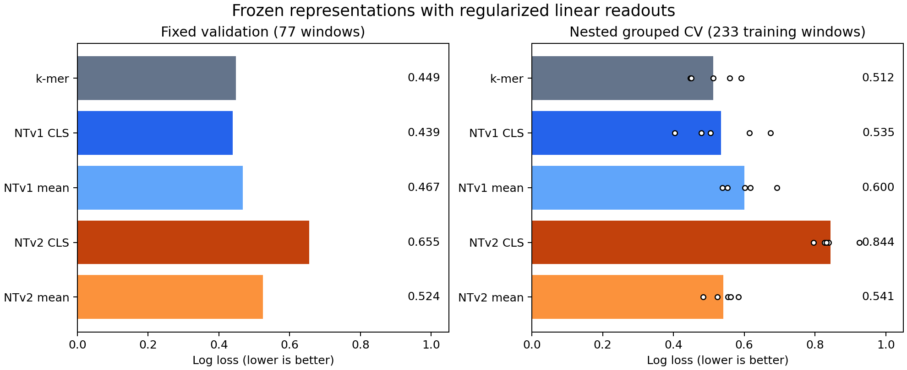

# Validation-only readout and pooling results — October 20, 2026

Masked-mean pooling improves the declared NTv2 linear probe relative to CLS on both fixed validation and nested grouped cross-validation. The k-mer baseline has the lowest pooled nested-CV log loss; these results do not establish a foundation-model advantage. The prior test cohort was not used for new fitting, selection, inference or scoring.

## Comparison

All new models use a standardized, L2-regularized logistic readout. Lower log loss is better. Fixed validation has 77 windows; nested out-of-fold results cover the 233 training windows. Each outer fold selects regularization using only three grouped inner folds; scaling is fitted separately inside each fitting partition.

| Representation | Validation log loss | Validation MCC | Nested pooled log loss | Nested pooled MCC |
|---|---:|---:|---:|---:|
| Oriented 1–4-mer | 0.449 | 0.565 | 0.512 | 0.514 |
| NTv1 raw CLS | 0.439 | 0.532 | 0.535 | 0.483 |
| NTv1 masked mean | 0.467 | 0.589 | 0.600 | 0.388 |
| NTv2 raw CLS | 0.655 | 0.323 | 0.844 | 0.032 |
| NTv2 masked mean | 0.524 | 0.506 | 0.541 | 0.441 |

Bars in the right panel show pooled outer out-of-fold log loss. White circles are individual outer-fold losses, not confidence intervals or independent biological replicates. Each outer model fits about 80% of training rows, fewer than the fixed-validation model; the two panels assess different fitting regimes.

All five model families select C=0.01 from the prespecified grid [0.01, 0.1, 1, 10, 100], both on fixed validation and in every outer fold's inner selection. This is the strongest tested regularization and lies at the grid boundary. The experiment does not establish the optimum outside that range. The grid was not expanded after seeing results.

NTv2 mean pooling lowers log loss in all five outer folds compared with NTv2 CLS. NTv1 CLS has lower loss than NTv1 mean in four of five outer folds. K-mer has lower loss than NTv1 CLS in three of five folds. The small fixed-validation advantage of NTv1 CLS over k-mer reverses in pooled nested CV; avoid declaring either clearly superior from that fixed holdout difference.

The encoder identities remain NTv1 500M human-reference and NTv2 500M multispecies, with the same pinned revisions as October 19. Generation, architecture and pretraining corpus remain confounded. Results concern these frozen final-layer representations, readouts and sampling definitions.

## What this says about the old nonlinear head

The earlier 512-unit GELU CLS probes had selected validation losses 0.4277–0.4358 for NTv1 and 0.6427–0.6488 for NTv2. The linear CLS readouts do not improve those validation losses. Thus this round does not support blaming NTv2's weak CLS performance solely on nonlinear-head capacity. NTv2 mean pooling is a useful representation control, but there is no matched nonlinear-mean experiment here. Scaling, regularization and optimization also differ from the historical head, so this is not an isolated test of linearity. No nonlinear-head nested CV was performed.

## Sampling audit

The training/validation audit verifies every retained sequence against the oriented source genome, checks labels against the curated starts, and finds no forbidden cross-split relationship under the established strand policy. It does not access test.csv.

| Split/class | Windows | Overlap same-strand CDS | Median CDS coverage |
|---|---:|---:|---:|
| Training negatives | 111 | 0 | 0% |
| Training positives | 122 | 65 | 53.7% |
| Validation negatives | 37 | 0 | 0% |
| Validation positives | 40 | 25 | 74.0% |

The negative extractor explicitly excludes same-strand CDS and selected positive windows. Positive windows follow a different rule and often include coding sequence. This creates a plausible genomic-context shortcut. It does not prove which features the fitted models use. GC fractions alone are similar between validation classes (0.40360 negatives, 0.40325 positives). Multiple recorded same-strand starts occur in 39 training and 17 validation positive windows, reinforcing that the label is window-level presence rather than identification of a unique start.

Preserve clean_v2 as the documented benchmark. Before making stronger TSS-specific or transfer claims, define context-matched negatives and window placement for a separate future cohort. See [sampling measurements](sampling-audit.json) and [independent evaluation and exposure plan](independent-evaluation-plan.md).

## Engineering and verification

- Initial extraction jobs 24697813_0/1 failed because tokenizer-generated special-token masks were one element longer than emitted token IDs. No embeddings were completed. The fix derives the exclusion mask directly from actual IDs using tokenizer.all_special_ids. Padding and every declared special-token ID are excluded; empty content masks fail. Failed output directories and logs are preserved.
- Corrected extraction jobs 24697844_0/1 completed in 39 seconds of SLURM time each, with extraction/inference taking about 6 seconds per encoder after environment startup. First-batch replay had zero hidden-state difference for both splits and encoders. Encoders run in eval/inference mode using the already repaired, pinned pretrained loader; no encoder tensors are trained.
- Initial analysis job 24697846 stopped at a strict readout replay check: mixed float32/float64 scaling differed by 4.63e-8. All embeddings are now promoted to float64 before fitting and prediction. The candidate grid, labels and selection rule were unchanged. Failed partial results remain separate.
- Final CPU analysis job 24697924 completed successfully. Exported readouts independently replay locally within 3.34e-16 absolute probability error, and validation metrics recompute correctly. All convergence warnings are treated as errors.
- Local regression suite: 19 passed, 2 opt-in large pretrained checks skipped. The new workflow test runs float32 synthetic embedding caches through the complete nested analysis with no test dataset file present. Synthetic regression test fixtures may contain their own test splits; no real clean_v2 test inference occurs.

This round reuses the frozen loader validated against pretrained weights in the October 19 work; it does not repeat all-tensor backbone comparison for the new extraction jobs. Cache/source hashes, revisions, package versions, extraction replay checks and export verification are in [provenance.json](provenance.json). SLURM timings and failures are in [jobs.psv](jobs.psv). Full candidate scores, fold memberships and all metrics are in [readout-metrics.json](readout-metrics.json). Per-window validation and training out-of-fold probabilities are saved beside this report.

## Completion and next step

The minimum comparison and the agreed follow-on backlog are complete: cached embeddings, validation readouts, nested grouped validation, sampling audit, independent-evaluation requirements and reproducible artifacts. No broader sweep or adaptation was launched, and no jobs remain running. Actual computation was much shorter than ten hours; completing the full backlog, rather than occupying the clock, is the stopping condition.

The next scientific priority is a defensible external cohort and negative-sampling definition. The independent-evaluation plan identifies a concrete AcMNPV annotation-validation study, but no compatible unseen-virus TSS cohort has yet been verified. The present results do not justify a larger-model or adaptation sweep.
