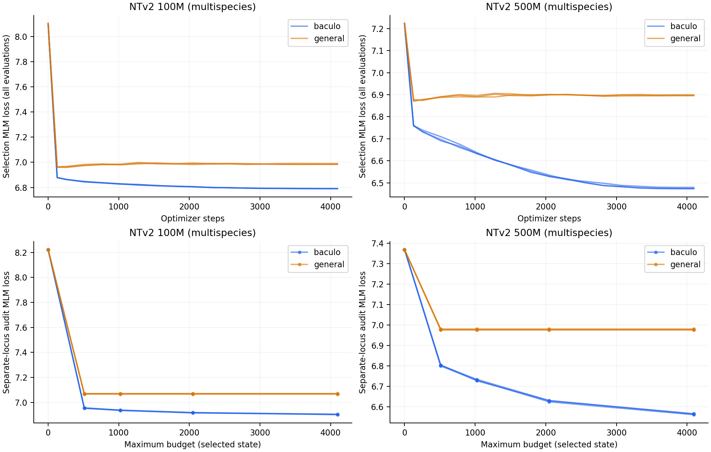
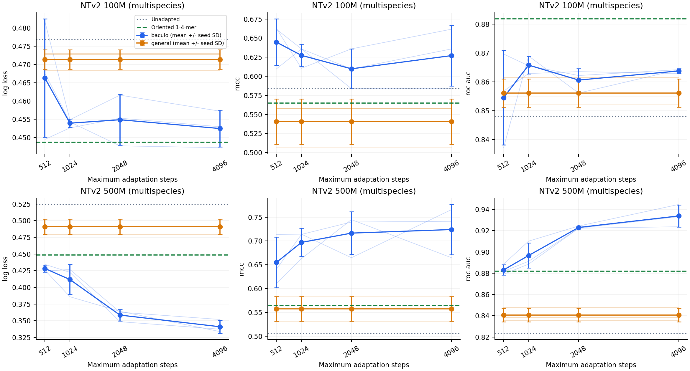
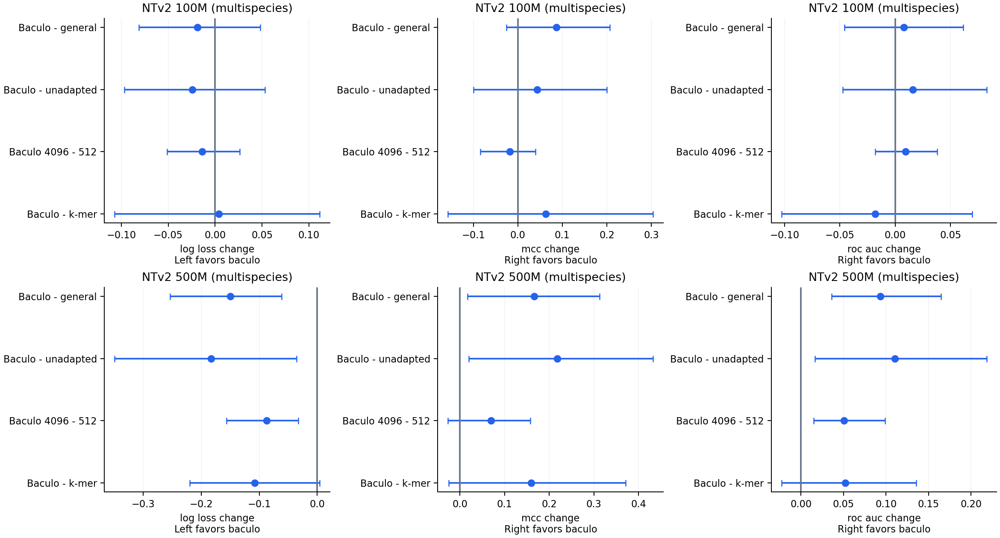
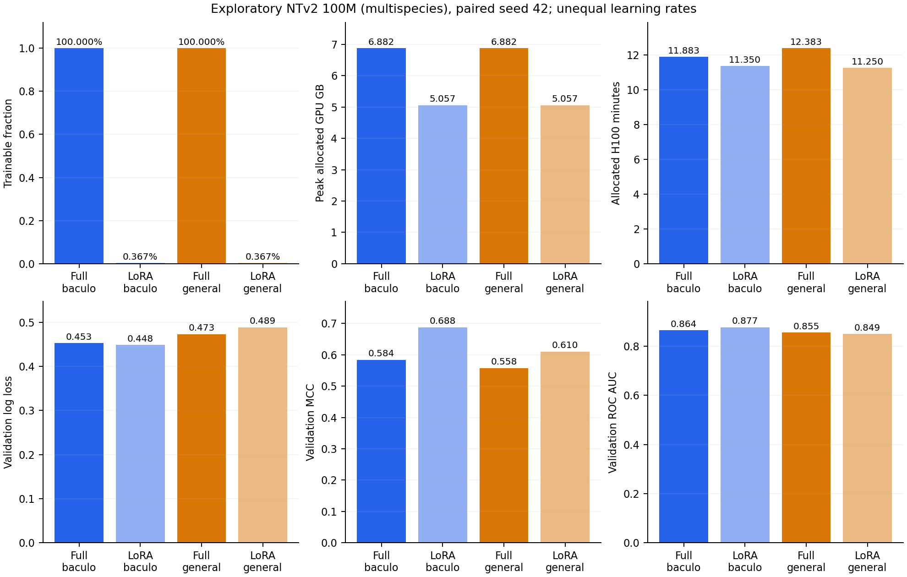

# Baculovirus adaptation of Nucleotide Transformer: viral benefit and general benchmark retention

Final scoped study report · October 26, 2026

## Abstract

Baculovirus continued pretraining improved a fixed regulatory-window probe built on multispecies NTv2 500M while preserving aggregate performance on the authors' revised human genomic benchmarks. On 77 AcMNPV validation windows, mean Matthews correlation coefficient (MCC) reached 0.724, versus 0.506 before adaptation and 0.558 after the specified general-genome control. Paired development intervals favored baculovirus adaptation over both controls for MCC, log loss and ROC AUC. Superiority over an oriented 1–4-mer logistic baseline remained unresolved. Across 18 human tasks, category-balanced MCC increased from 0.5795 to 0.5923, meeting the predeclared overall preservation margin. Preservation across every task was not established: four histone tasks could not exclude a loss exceeding 0.05 MCC under simultaneous bounds. These findings support useful specialization under the tested frozen linear-probe procedures, without establishing cross-baculovirus generalization, universal preservation or the necessity of adaptation.

## Study question and scope

The study asks whether adaptation adds useful signal beyond broad-genome pretraining, whether longer adaptation helps, and whether specialization compromises general prediction. Both primary models—NTv2 100M and 500M—were originally pretrained on multispecies genomes. This is not a human-only versus viral pretraining comparison.

The primary evidence combines the completed adaptation-duration study and approved 500M retention extension. A single-seed 100M LoRA pilot supplies exploratory resource measurements. Historical short-budget and 2.5B results provide context, rather than extra candidates selected using present outcomes. Benchmark context comes from the [NT article](https://doi.org/10.1038/s41592-024-02523-z), [official repository](https://github.com/instadeepai/nucleotide-transformer), and [author-prepared revised dataset](https://huggingface.co/datasets/InstaDeepAI/nucleotide_transformer_downstream_tasks_revised).

## Methods

### AcMNPV cohort and data integrity

The cohort comprises 388 oriented 300-base windows from AcMNPV NC_001623.1: 233 training, 77 validation and 78 reserved test windows. Positive/negative counts are 122/111, 40/37 and 41/37 respectively. Connected grouping joins same-strand overlapping intervals and documented ORF/sequence/cluster relationships before partitioning. Audits found no shared group or ORF, forbidden same-strand coordinate overlap, or same-strand exact/reverse-complement duplicate between splits. Opposite-strand overlaps are permitted under the accepted policy. Three invalid historical rows were excluded; retained sequences and labels were preserved.

The annotation audit identified eight windows including exactly one base of their assigned downstream CDS and one training window overlapping an earlier segment of its assigned compound CDS. Other-gene overlap is accepted. Positive and negative sampling differ in coding-region overlap, which can influence discrimination; the task remains conditional on that sampling definition. These checks do not exclude every distant homology or pretrained exposure. [Dataset repair](evidence/audits/dataset-repair.txt), [CDS audit](evidence/audits/cds-audit.txt), and [sampling audit](evidence/audits/sampling-audit.json) retain the evidence.

The AcMNPV test cohort was inspected in earlier project history. It was not predicted in these studies and is not a pristine independent external test. All viral task results below are validation results.

### Adaptation and frozen viral readout

Each size used full-parameter baculovirus and general-genome adaptation with seeds 42/43/44, restarted from original pretrained weights. The fixed maximum was 4,096 steps, effective batch 32, AdamW learning rate 1e-5, weight decay 0.01, 26 warmup steps and cosine decay. Conditions matched maximum steps and paired input/masked-token exposure; each full run processed 33,685,504 input tokens. The target genome was excluded under the documented target-name/duplicate policy. Related species remain possible sources of transfer. The general control used a yeast/worm/fly subset, not a reconstruction of the original pretraining mixture.

At budgets 512/1,024/2,048/4,096, the best eligible trained state was selected only using fixed viral masked-language-model (MLM) validation. A separate-locus 256-window audit did not affect selection. It shares nine held-out species groups with selection, supplying additional loci rather than independent species replication. The practical stopping diagnostic required less than 0.5% cumulative-best selection-loss improvement in the final 1,024 steps.

Frozen final-layer masked-mean embeddings fed standardized logistic classifiers. Pooling and NT regularization C=0.01 were fixed by earlier training-only grouped selection. Scalers and classifiers used only 233 training windows; existing k-mer settings and threshold >0.5 were retained. Scores average seed-specific metrics, not ensemble predictions. Paired 95% intervals use 2,000 resamples of the same 64 validation groups and condition on fitted models and this cohort. They are unadjusted development intervals, not full training/selection uncertainty.

Duration comparisons use prefixes of one 4,096-step schedule, not independently optimized short/long schedules. General checkpoints select early, so equal maximum budgets do not imply equal selected exposure. [Adaptation protocol](evidence/adaptation/protocol.md).

### Human benchmark retention

Seven frozen NTv2 500M multispecies backbones were evaluated: original plus all three existing baculovirus and three general states selected at the 4,096 maximum budget. No new backbone training was required. Dataset revision: `851f9946252e90c665cdb3cc3eedb78f1f26197c`. Original model revision: `06615c1660c892fc199840c18123f8385b3542a8`.

The official 493,242 labelled training and 38,822 labelled test windows were preserved across three promoter, two enhancer, three splice and ten histone tasks. Test chromosomes were 20/21. Audits found no train/test chromosome sharing, coordinate overlap or exact/reverse-complement matches across tasks. Sequence reuse reduced feature extraction to 434,501 unique training and 32,388 unique test sequences per backbone without dropping labelled rows.

On the original model's training features only, three chromosome-grouped folds chose mean-pooled layer depth from 8/15/22/29 and C from 0.001/0.01/0.1/1/10 by pooled out-of-fold log loss. Settings were frozen and independently collected before test prediction. Four tasks chose layer 8 and fourteen layer 15. Per-task settings were fixed across all seven backbones, with each scaler/classifier refitted on its own training features. Binary decisions used >0.5; multiclass decisions used argmax. This measures retention after fitting small linear heads, rather than unchanged existing-head compatibility or reproduction of the paper's best fine-tuned leaderboard scores.

The aggregate averages MCC within each family, then weights all four families equally. Allowable declines were 0.02 overall and 0.05 per task—study choices, not NT-author standards. Uncertainty used 20,000 common paired resamples of 107 genomic blocks, derived from chromosome/1-Mb bins joined where windows cross boundaries. Overall preservation used a one-sided 95% lower bound; an all-task claim required Bonferroni-adjusted one-sided bounds across 18 tasks. Ordinary two-sided 95% intervals describe effects. Blocks approximate spatial dependence and are not biological replicates. [Retention protocol](evidence/retention/protocol.md) and [pre-test freeze](evidence/retention/pre-test-freeze-verification.json).

## Results

### Viral MLM adaptation shows diminishing returns

All six full baculovirus trajectories met the practical plateau rule. Final-1,024-step best-loss gains were 0.0209–0.0432% for 100M and 0.1303–0.1513% for 500M. Independent audit loss improved at every successive budget: approximate original-to-final losses were 8.223→6.90 for 100M and 7.370→6.56 for 500M. Cosine decay contributes to flattening; this supports stopping under the tested schedule, not universal convergence.

General controls selected steps 128/128/256 for 100M and 256/128/128 for 500M. Later selection losses deteriorated slightly; selected states stayed identical across budgets. Flat general readout curves reflect unchanged selection, not evidence that general learning stopped.

*Figure 1. Individual full-training seeds. Panels use different loci/masks, so their absolute losses are not interchangeable. General audit curves reuse early selected states.*

### The 500M development probe improves; k-mer superiority remains unresolved

| Model / condition | Log loss ↓ | MCC ↑ | ROC AUC ↑ |
|---|---:|---:|---:|
| 100M original | 0.477 | 0.584 | 0.848 |
| 100M general | 0.471 ± 0.003 | 0.541 ± 0.030 | 0.856 ± 0.005 |
| 100M baculovirus | 0.452 ± 0.005 | 0.627 ± 0.040 | 0.864 ± 0.001 |
| 500M original | 0.524 | 0.506 | 0.824 |
| 500M general | 0.491 ± 0.012 | 0.558 ± 0.026 | 0.841 ± 0.006 |
| 500M baculovirus | 0.341 ± 0.010 | 0.724 ± 0.053 | 0.934 ± 0.010 |
| Oriented 1–4-mer logistic | 0.449 | 0.565 | 0.882 |

*Table 1. AcMNPV validation at the fixed 4,096 maximum budget. Adapted entries are mean ± sample SD across seeds, not confidence intervals. All NT models are multispecies pretrained; general entries use early MLM-selected states.*

| 500M comparison, left minus right | Log-loss change [95% interval] | MCC change [95% interval] | AUC change [95% interval] |
|---|---:|---:|---:|
| Baculovirus − original | −0.1832 [−0.3495, −0.0356] | +0.2176 [+0.0194, +0.4326] | +0.1101 [+0.0164, +0.2181] |
| Baculovirus − general | −0.1498 [−0.2536, −0.0611] | +0.1664 [+0.0169, +0.3131] | +0.0930 [+0.0360, +0.1648] |
| Baculovirus 4096 − 512 prefix | −0.0873 [−0.1564, −0.0329] | +0.0691 [−0.0267, +0.1575] | +0.0507 [+0.0148, +0.0988] |
| Baculovirus − k-mers | −0.1076 [−0.2200, +0.0042] | +0.1593 [−0.0254, +0.3708] | +0.0520 [−0.0230, +0.1356] |

*Table 2. Paired conditional development effects. K-mer comparisons and added AUC intervals are supplementary; no outcome changed selection.*

The 500M endpoint improves all three metrics over both controls. Longer adaptation improves probability quality and ranking; its incremental MCC gain remains unresolved. All 100M endpoint and duration intervals cross zero. Clear MLM improvement alone therefore does not establish downstream gain. Neither model establishes superiority over the inexpensive k-mer baseline.

*Figure 2. Fixed readout outcomes by maximum budget. Thin lines show seeds; error bars show sample SD. These curves did not select a downstream-winning budget.*

*Figure 3. Planned endpoint effects and supplementary k-mer comparisons with paired intervals. Positive MCC/AUC and negative log loss favor adaptation.*

### General performance is preserved overall, with task-specific limits

| Family | Tasks | Original MCC | Baculovirus MCC | General MCC | Baculovirus − original [95% interval] |
|---|---:|---:|---:|---:|---:|
| Promoter | 3 | 0.7359 | 0.7721 | 0.7613 | +0.0363 [+0.0054, +0.0676] |
| Enhancer | 2 | 0.4855 | 0.4948 | 0.4762 | +0.0093 [−0.0095, +0.0282] |
| Splice | 3 | 0.5694 | 0.5826 | 0.6081 | +0.0132 [+0.0029, +0.0232] |
| Histone | 10 | 0.5270 | 0.5195 | 0.5172 | −0.0075 [−0.0161, +0.0010] |
| **Category-balanced overall** | **18** | **0.5795** | **0.5923** | **0.5907** | **+0.0128 [+0.0028, +0.0227]** |

*Table 3. Mean seed-specific MCC and common paired genomic-block effects. No separate family-level preservation threshold was declared.*

The overall one-sided 95% lower bound was +0.0043, above the allowable −0.02 decline. Overall preservation is supported. Baculovirus minus general was only +0.0016 [−0.0046, +0.0077], with no clear overall human-task advantage specific to viral exposure.

Nine task MCC points improved and nine declined; none lost more than 0.05. The promoter-family gain was driven largely by the 212-window TATA subgroup (+0.1140 MCC); all-promoter and no-TATA points declined slightly. The aggregate gain is not uniform improvement.

*Figure 4. Family and equal-family overall effects. The −0.02 reference applies only to the overall score.*

At ordinary one-sided 95% confidence, 17/18 tasks met their margin. Under the simultaneous criterion, 14/18 met it, leaving four histone tasks unresolved:

| Task | MCC change | Ordinary paired 95% interval | Simultaneous one-sided lower bound |
|---|---:|---:|---:|
| H3K27ac | −0.0182 | [−0.0462, +0.0083] | −0.0588 |
| H3K4me3 | −0.0114 | [−0.0419, +0.0211] | −0.0544 |
| H3K9ac | −0.0078 | [−0.0401, +0.0243] | −0.0535 |
| H3K9me3 | −0.0156 | [−0.0612, +0.0318] | −0.0803 |

*Table 4. Each simultaneous lower bound would need to exceed −0.05 for the stronger all-task claim. Unresolved limits do not demonstrate declines exceeding 0.05.*

No task showed supported material degradation beyond the margin. Nine histone tasks also had worse log-loss and AUC points. H3K27ac log loss increased +0.0096 [+0.0009, +0.0182], nominal unadjusted evidence of a small cost. Supporting metrics reinforce the nonuniform interpretation. Complete effects accompany the report.

*Figure 5. Mean and individual-seed effects across all 18 tasks. Plotted ordinary two-sided intervals differ from the simultaneous one-sided decision bounds in Table 4.*

*Figure 6. The same fixed 500M states on AcMNPV validation and human benchmark test data. Seed points and means do not represent independent biological replication.*

### Exploratory LoRA feasibility

The 100M seed-42 pilot used query/value rank-8 adapters, alpha 16, frozen original parameters and learning rate 1e-4, compared with full-training rate 1e-5. LoRA trained 360,448 parameters (0.367% of its total), reducing observed peak allocated GPU memory from 6.882 to 5.057 GB, about 26.5%. Training-section time fell roughly 6%. Baculovirus LoRA minus paired full-training MCC changed +0.1041 [−0.0087, +0.2383]; loss and AUC intervals also crossed zero. This establishes feasibility and measured memory savings, without superiority, equivalence or noninferiority from one unequally tuned seed.

*Figure S1. Single-seed resource/performance comparison. Training, program and allocation times are distinct; performance effects remain exploratory.*

## Verification and compute

The adaptation analysis checked 14 scientific runs and 59 readouts, reproduced checkpoint choices/plateaus, checked train-only scaling, and replayed probabilities within 4.44e-16 maximum absolute error. Existing intervals and independent audit identities reproduced. Prior server fresh-process embedding checks had maximum difference 0.0.

All 126 retention readouts passed server verification and independent local metric/statistical replay. Train-only scales and complete coefficient-to-test-probability replay checked exactly; fresh-process 64-row train/test checks reproduced all four candidate layers in all seven backbones with maximum difference 0.0. The local verifier independently reconstructed genomic blocks and regenerated all 20,000 bootstrap weights and bounds. Hashes tied states to earlier evidence and settings to the pre-test freeze.

Retention consumed **1.813 H100 allocation hours**, including smoke and replay, with at most two study GPUs active. This is allocation time, not monetary cost or utilization. Full adaptation job accounting and pilot measurements are supplied separately; this subtotal is not a whole-project total. Two initial CPU module-path failures and a cancelled I/O-bound verifier were preserved. Its replacement changed reading order/memory allocation while retaining numerical checks. Final assembly performed no training or model inference.

## Discussion and limitations

The strongest supported claim is that the tested 500M specialization improves this AcMNPV development probe while maintaining aggregate performance on the supplied human probes after classifier refitting. Concordant metrics distinguish the viral endpoint from the specified general control. The 100M result shows why lower MLM loss alone cannot serve as downstream success.

Evidence remains bounded by one viral genome, a small repeatedly examined validation cohort, accepted strand/group and negative-sampling policies, and conditional development intervals. Seeds quantify optimization variation, not biological replication. Historical test exposure and possible unlabeled pretraining exposure further limit independence. An independently annotated additional species would be needed for cross-baculovirus claims.

The human benchmark supports the agreed aggregate preservation criterion but does not certify every task, unchanged existing heads, long-context functions, all layers or all genomic capabilities. Test chromosomes were held out from supervised head fitting, not necessarily original pretraining. Equal maximum budgets leave unequal MLM-selected exposure. The general corpus does not isolate a promoter mechanism or represent every possible control.

K-mer superiority, formal LoRA comparisons and broad model-size conclusions remain unresolved. More optimization is not required to finish this report and would not itself provide independent biological evaluation. Keeping the original checkpoint available remains prudent where task-specific retention matters.

## Conclusion

The study supports a 500M domain-specific benefit on AcMNPV development data and overall preservation on the revised NT benchmark. K-mer superiority and four task-level preservation limits remain unresolved. These qualified findings close the approved experimental scope. Any future AcMNPV internal test evaluation requires a separate decision using the already fixed panel and an explicit historical-exposure disclosure.

## References and accompanying material

1. Dalla-Torre, H. et al. *Nucleotide Transformer: building and evaluating robust foundation models for human genomics.* Nature Methods **22**, 287–297 (2025). [Article and DOI](https://doi.org/10.1038/s41592-024-02523-z).
2. InstaDeep. [Official Nucleotide Transformer repository](https://github.com/instadeepai/nucleotide-transformer).
3. InstaDeep. [Revised dataset, exact revision](https://huggingface.co/datasets/InstaDeepAI/nucleotide_transformer_downstream_tasks_revised/tree/851f9946252e90c665cdb3cc3eedb78f1f26197c).
4. Microsoft. [LoRA reference implementation](https://github.com/microsoft/LoRA/blob/main/loralib/layers.py), implementation context for the pilot.

[Reproducibility index](reproducibility.md) · [Figure and table index](assets.md) · [Adaptation effects](tables/adaptation-paired-effects.md) · [All benchmark effects](tables/retention-paired-effects.md)
