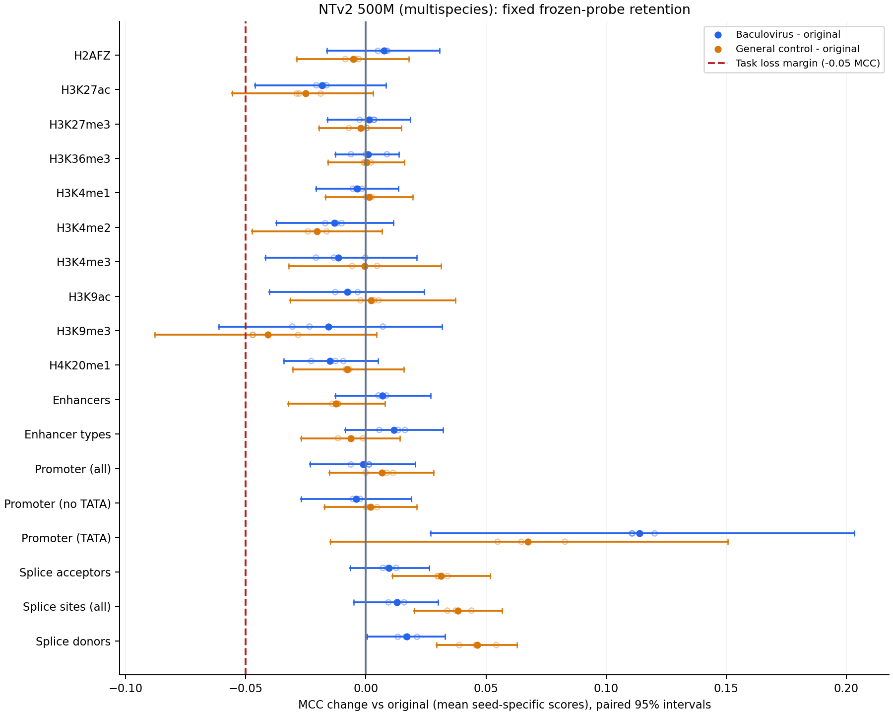
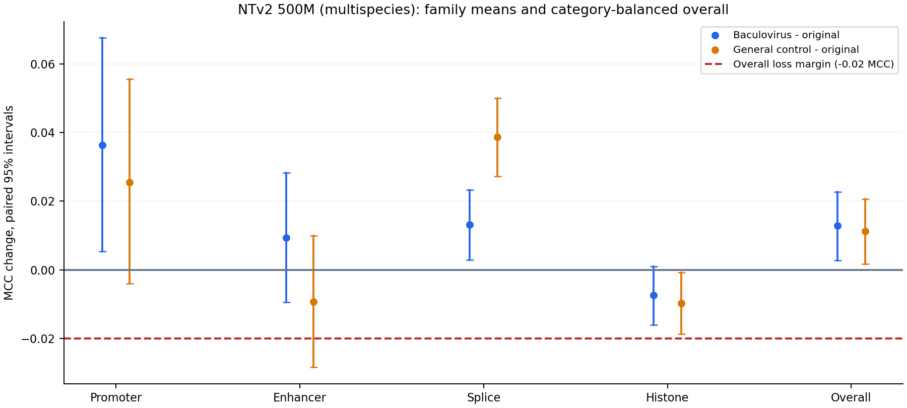
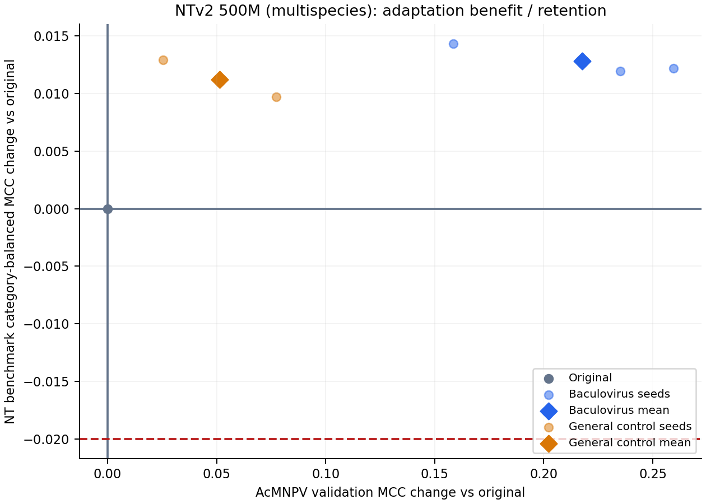

# NTv2 500M multispecies: general benchmark retention

All18 revised NT benchmark tasks evaluated with frozen backbones, train-only selected logistic probes and the existing4096-budget selected adaptation states. No backbone training or AcMNPV test inference. These are fixed-probe retention results, not a replication of the paper's fine-tuned leaderboard.

| Task | Original MCC | Baculo MCC (mean seeds) | General MCC (mean seeds) | Baculo-original [95% CI] | Preservation at .05 margin |
|---|---:|---:|---:|---:|---|
| H2AFZ | 0.4621 | 0.4696 | 0.4568 | +0.0075 [-0.0163, +0.0307] | preservation supported |
| H3K27ac | 0.4918 | 0.4736 | 0.4667 | -0.0182 [-0.0462, +0.0083] | preservation supported |
| H3K27me3 | 0.5708 | 0.5722 | 0.5687 | +0.0014 [-0.0160, +0.0185] | preservation supported |
| H3K36me3 | 0.5705 | 0.5714 | 0.5708 | +0.0009 [-0.0128, +0.0137] | preservation supported |
| H3K4me1 | 0.4614 | 0.4577 | 0.4628 | -0.0037 [-0.0207, +0.0135] | preservation supported |
| H3K4me2 | 0.5274 | 0.5143 | 0.5071 | -0.0130 [-0.0372, +0.0115] | preservation supported |
| H3K4me3 | 0.6346 | 0.6231 | 0.6341 | -0.0114 [-0.0419, +0.0211] | preservation supported |
| H3K9ac | 0.5270 | 0.5192 | 0.5292 | -0.0078 [-0.0401, +0.0243] | preservation supported |
| H3K9me3 | 0.4024 | 0.3867 | 0.3616 | -0.0156 [-0.0612, +0.0318] | unresolved |
| H4K20me1 | 0.6221 | 0.6071 | 0.6144 | -0.0149 [-0.0342, +0.0051] | preservation supported |
| enhancers | 0.5092 | 0.5161 | 0.4968 | +0.0069 [-0.0126, +0.0269] | preservation supported |
| enhancers_types | 0.4618 | 0.4736 | 0.4555 | +0.0118 [-0.0085, +0.0321] | preservation supported |
| promoter_all | 0.7450 | 0.7438 | 0.7517 | -0.0012 [-0.0232, +0.0206] | preservation supported |
| promoter_no_tata | 0.7524 | 0.7485 | 0.7545 | -0.0039 [-0.0270, +0.0188] | preservation supported |
| promoter_tata | 0.7101 | 0.8241 | 0.7776 | +0.1140 [+0.0270, +0.2033] | preservation supported |
| splice_sites_acceptors | 0.6450 | 0.6547 | 0.6764 | +0.0096 [-0.0066, +0.0263] | preservation supported |
| splice_sites_all | 0.4293 | 0.4421 | 0.4677 | +0.0129 [-0.0051, +0.0301] | preservation supported |
| splice_sites_donors | 0.6340 | 0.6511 | 0.6803 | +0.0171 [+0.0005, +0.0329] | preservation supported |

Category-balanced mean MCC change, baculovirus-original: +0.0128 [+0.0028, +0.0227]. One-sided95% lower bound +0.0043, proposed margin -.02: **preservation supported**.
All18 task preservation at -.05 using multiplicity-adjusted one-sided bounds: **False**. Marginal task intervals cannot alone establish an all-task guarantee.

Readouts use mean-pooled embeddings; layer/C were selected only on original training features with chromosome-grouped folds and then fixed across conditions. Classifiers/scalers were independently fitted on each training representation. Scores are means of seed-specific metrics, not ensemble predictions. Binary threshold>.5; multiclass argmax. MCC is primary; scores.csv also retains log loss and macro OvR ROC AUC.

Uncertainty uses 20000 valid paired resamples of common chromosome/1Mb genomic blocks (20000 requested), with overlapping windows joined across bins and common weights across related tasks. Intervals condition on these models, readouts and supplied human benchmark. They do not supply independent species replication or guarantee general retention beyond this benchmark. Task-family means are weighted equally in the overall score; the ten histone tasks do not dominate.

The official chromosome-held-out splits are preserved. No train/test coordinate overlap or exact/RC matches were found. Human genome pretraining exposure is expected; benchmark test chromosomes are held out from supervised probe fitting, not necessarily from original pretraining. The small promoter-TATA test and correlated task definitions can limit precision. AUC/log loss disagreements must be examined alongside MCC before a practical conclusion.

verification.json records independent full-test coefficient replay, full-training scaler checks, metric recomputation, source/dataset/embedding hashes and frozen settings. Large vectors and model states stay on Nibi. The parent protocol/execution files retain design, jobs, failures and timing. Figures are exported as PNG/PDF.
